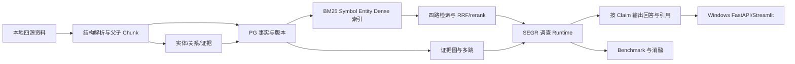

# 系统架构与运行拓扑

运行边界：Windows Python 进程承担解析、索引构建、NetworkX 图、策略、API/UI和评估；Docker Desktop Linux containers 仅 PostgreSQL/Qdrant，通过 localhost 映射端口通信。没有 Redis、应用容器、Ubuntu 开发环境或 WSL 工程路径。

| 模块 | Owner | 职责与依赖 |
|---|---|---|
| core/models/ports/providers | B00 | 公共类型、配置、预算、错误、provider adapters/fake；不 import 业务 |
| ingestion | B01 | 文件 manifest、结构、chunk/locator；不写数据库 |
| extraction | B02 | AST/LLM 抽取和 evidence 校验；输入 B00 DTO，可与 B01 并行 |
| storage/indexing | B03 | PG migration、索引、GraphStore、generation、PipelineService 装配 B01/B02 |
| retrieval | B04 | BM25/Dense/Symbol/Entity wrappers、RRF、rerank、registry；不 import graph |
| graph | B05 | 从 B03 GraphSnapshot/EntityIndex 检索 seed/paths；不 import retrieval |
| agent | B06 | 真实四路+Graph 装配、SEGR、规则/LLM 对照策略、状态和回答 |
| evaluation/benchmarks | B07 | Gold、指标、记录、policy 拟合输入、矩阵；核心业务不 import evaluation |
| api/ui/cli | B08 | composition root、HTTP、演示；不复制检索/导入算法 |

PG 是规范事实唯一来源，Qdrant/本地 BM25/NetworkX 是派生读取。数据 generation 为不可变快照：先建立 BUILDING 与成员；写入并验证 PG 引用、Qdrant vectors、本地索引 manifest；全部成功后 PG CAS 切 active_generation。失败保持旧 active 可查，不能把单库事务当跨库事务。

查询开始固定 corpus_id+generation_id，所有检索、图、claim 引用沿用；请求租约保护旧 generation，默认发布后至少保留24h且无租约才 GC。来源逻辑删除发布新 generation；物理删除另有受控 GC，不声称即时抹去所有备份。临时 API key/URL 不进入 generation。

本地索引存 data/indexes/<corpus>/<generation>/ 的 JSON/NumPy 安全格式，不反序列化 pickle。Qdrant point_id 包含 generation+chunk+embedding_fingerprint，更新不覆盖旧请求的 points。每个 chunk span 有持久化基础 Evidence，即使没有实体抽取也能给出可解析文本引用。

图接口由 B00 先冻结，B03 同时交付 GraphStore 和四路 CandidateIndex，B04/B05 因而可以并行。GraphRetriever 返回统一 leaf chunk 命中与 paths，B06 注册进通用检索器 registry；B05 不需要 B04 的实现。全部 source filter 在候选搜索/图扩展前生效，不能通过被过滤来源中转。

任务运行与应用调查分开：Orchestrator 的工程账本位于 .kw/runtime；业务 Investigation 在 PG/运行 artifacts 中。两者不共享状态枚举，也不能将 Agent 的 answered 当作 Batch COMPLETED。
