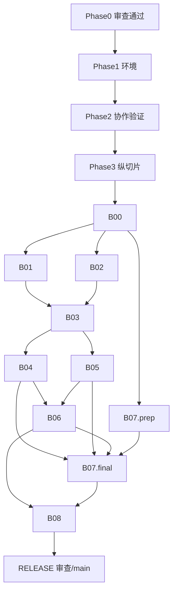

# 固定DAG、阶段与并行

机器可读唯一依赖表：state/planning/dependencies.json。此页与每个Batch由同一固定表核对。Stage完成与业务集成的不同门槛详见TASK_LEDGER。

| 节点 | 依赖 | 独立修改主范围 | 阶段 |
|---|---|---|---|
| B00 | P3 COMPLETED | core/models/ports/providers与依赖锁 | 4 |
| B01 | B00 | ingestion | 4 |
| B02 | B00 | extraction | 4 |
| B07.prep | B00 | evaluation/Gold/指标 | 4 |
| B03 | B01+B02 | storage/indexing/migrations | 4 |
| B04 | B03 | retrieval | 4 |
| B05 | B03 | graph | 4 |
| B06 | B04+B05 | agent/SEGR | 4 |
| B07.final | prep+B04+B05+B06 | policy拟合/实验/报告 | 5 |
| B08 | B06+B07.final | api/ui/cli | 6 |

B00后B01/B02/B07.prep可占满3槽；B03不等待prep。B03后B04/B05并行，余槽可继续prep；B06需两者集成。B07.final必须等完整实现且prep集成；它新建独立会话而不是携带prep全部聊天。B08不能在prep完成时提前启动。B07是一个Batch的两个固定阶段，不是Orchestrator重新拆分。

B02基于B00fixture实现，不依赖B01；B05基于B03 GraphSnapshot与EntityIndex，不依赖B04；B04基于通用Retriever接fake graph，B06装配真实graph；B07.prep用原文Gold locator不等parser；B06实现policy weights加载，B07.final只生成参数文件不改算法源码。不存在evaluation反向依赖。

每节点只修改其模块+tests/<node>+docs/implementation/<node>.md+docs/deliveries/<node>.md。共享接口变更走CR，由技术负责人指定一个Work实施并同步消费者。详细独立任务与完整提示词见docs/batches/B00.md至B08.md。
